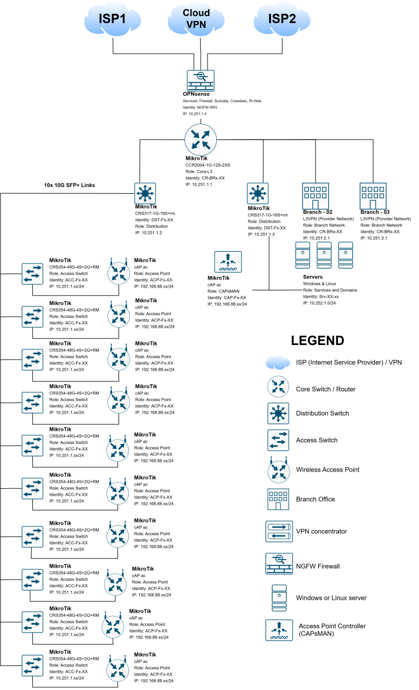
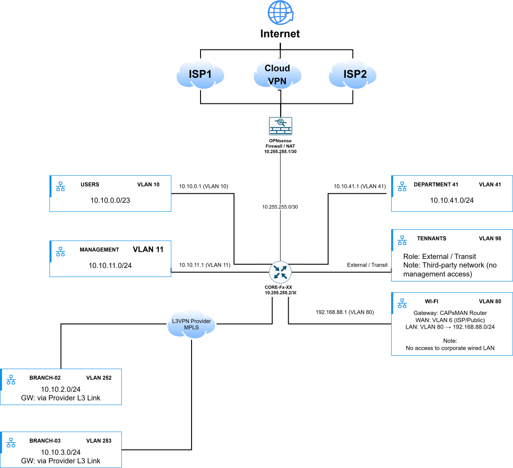
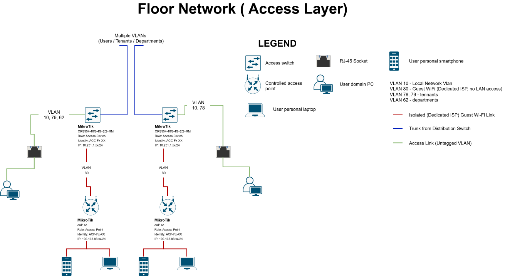
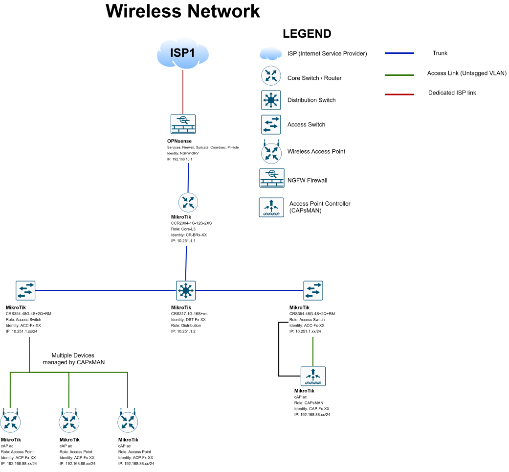

# Network Architecture and RouterOS Lab Examples

Reference network diagrams and selected configuration patterns curated by [Ilia Boginia](https://iliaboginia.github.io/), Network & Infrastructure Engineer.

These examples are adapted from operational work and rewritten as independent lab scenarios. Device identities, addressing, VLAN numbers, port assignments, site labels and service names are fictional. They do not document an employer's network. The diagrams and configuration examples are separate illustrations, not a single deployable network.

## Case studies

[Office network redesign](case-studies/office-network-redesign/) — original and redesigned topology, completed switch replacement work and migration preparation. Editable draw.io files are included separately for both versions.

[Dedicated WAN routing and WireGuard](case-studies/policy-based-routing/) — a subsidiary VLAN with a separate Internet circuit, access to head-office services and remote VPN connectivity.

[Browse case studies](case-studies/).

## Selected configuration examples

| Example | Engineering focus |
| --- | --- |
| [Access switch VLAN filtering](configs/01-access-vlan.rsc) | Tagged uplink, untagged endpoint ports, management VLAN and ingress filtering. |
| [Distribution switch protections](configs/02-distribution-rstp.rsc) | VLAN trunks, RSTP priority, DHCP snooping and a protected endpoint port. |
| [L3 segmentation](configs/03-l3-segmentation.rsc) | VLAN gateways, DHCP and explicit firewall boundaries between users, guests and management. |
| [Policy-based routing](configs/04-policy-routing.rsc) | Source-based routing tables, internal-destination exceptions and a distance-based backup route. |

I selected representative access, distribution, core and edge patterns from the supplied exports. Repeated access-switch exports were omitted because they add little new engineering detail. Raw dumps, DHCP leases, DNS records, SNMP communities, VPN peers, PPP accounts, scripts, schedules, keys and device metadata are excluded.

The snippets are deliberately shortened and hardened for learning: they are **not verbatim exports**, audited production baselines or claims that every safeguard was deployed in the original network. No official vendor certification is implied.

## Reference diagrams

Only identifying labels are changed during anonymization; diagram geometry and connections are retained. Address labels such as `HOST001` and `V001` are abstract placeholders, not IP addresses. These diagrams demonstrate documentation and communication, not access to a production environment.

### High-level architecture

### Logical segmentation

### Access and wireless

Editable source files are in [`diagram/xml/`](diagram/xml/).

## Lab validation

Examples assume RouterOS 7 and named lab interfaces. Read each file's prerequisites first. Use an isolated lab with console access and RouterOS Safe Mode; map interface names before applying commands. Bridge VLAN filtering is enabled after port and VLAN membership is defined. L3 examples assume software routing; hardware offload behavior is platform-dependent and must be checked separately.

Review syntax and, where supported by your RouterOS release, use import dry-run before applying. Verify management reachability, tagged/untagged VLAN membership, guest isolation, DHCP, route selection and failover. The policy-routing example checks directly connected gateways; it does not demonstrate end-to-end internet health checks or session-preserving failover.

These examples have been checked statically, not imported into live equipment. See [validation checklist](docs/lab-validation.md).

## More work

[Python network operations toolkit](https://github.com/iliaboginia/portfolio) · [Website and resume](https://iliaboginia.github.io/)
