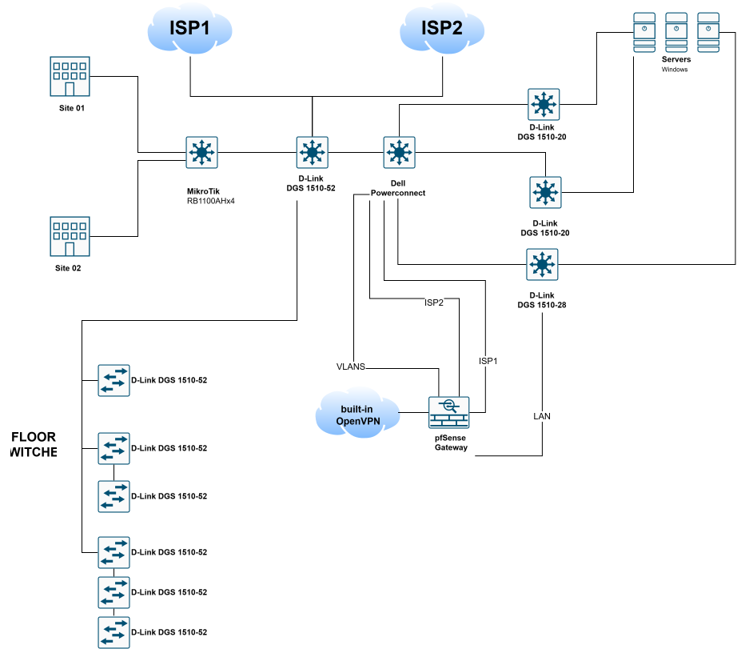
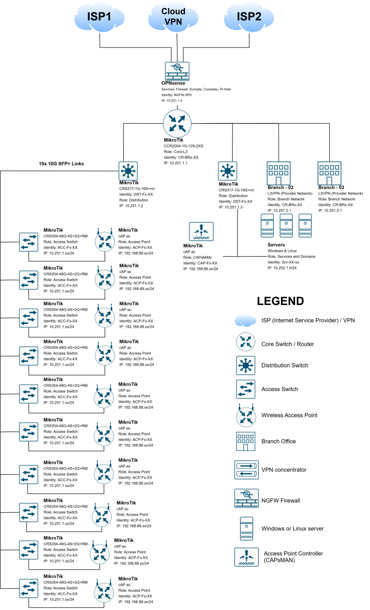

# Office Network Redesign

## Problem

The existing office network had outdated equipment and a complicated topology, with several devices performing overlapping functions. The goal was to simplify the architecture and make the network easier to manage while supporting daily operations.

## My role and approach

I reviewed the existing topology, redesigned device roles and prepared routing, VLAN and firewall configurations for the new setup. I also replaced older switches with MikroTik devices in stages, scheduling disruptive changes outside business hours.

The main challenge was planning changes around the existing connectivity requirements and dependencies between devices and uplinks.

## Original topology

This is a simplified sketch of the original network, including the legacy switching equipment, pfSense gateway and connections between sites.

[Editable draw.io diagram](old-network.drawio.xml) · [Full-size SVG](old-network.drawio.svg)

## Redesigned topology

The redesigned diagram separates the firewall, core routing, distribution and access roles. It includes OPNsense, a MikroTik CCR2004 core, CRS317 distribution switches, CRS354 access switches and wireless access points.

[Editable draw.io diagram](redesigned-network.drawio.xml) · [Full-size SVG](redesigned-network.drawio.svg)

## Implementation status

The target design and configurations have been prepared, and switch replacement has been carried out in stages. The final production cutover to the redesigned routing and firewall arrangement is the next step.

## Diagram files

| File | Description |
| --- | --- |
| [old-network.drawio.xml](old-network.drawio.xml) | Editable original topology supplied for this case study. |
| [old-network.drawio.svg](old-network.drawio.svg) | Browser preview of the original topology. |
| [redesigned-network.drawio.xml](redesigned-network.drawio.xml) | Separate editable copy of the redesigned high-level architecture. |
| [redesigned-network.drawio.svg](redesigned-network.drawio.svg) | Browser preview of the redesigned architecture. |

Site names and identifiers are generic. The drawings are simplified explanatory views, not complete operational inventories or deployment configurations.
