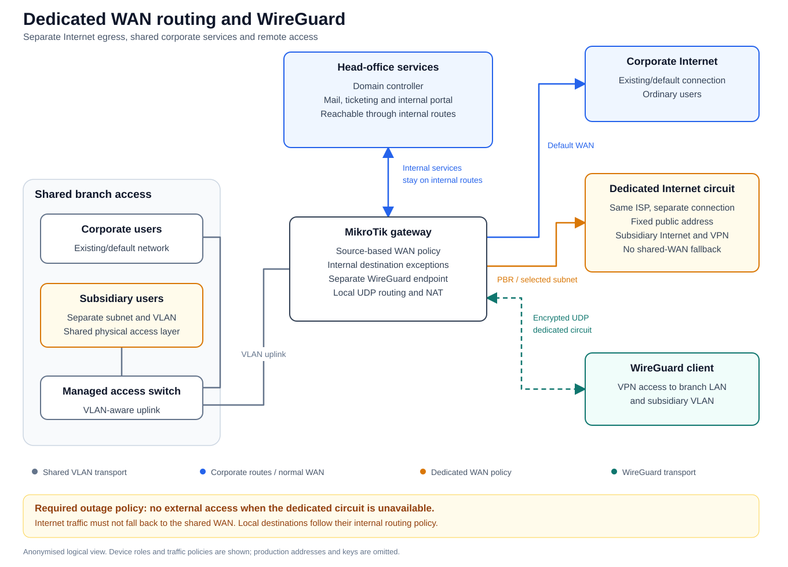

# Dedicated WAN Routing and WireGuard for a Subsidiary

## Business requirement

A subsidiary shared the branch's access-switch infrastructure with ordinary corporate users. It needed a separate subnet and VLAN, plus its own Internet circuit and public IP for a dedicated service. Both Internet connections were supplied by the same ISP.

Employees also needed access to the head-office domain controller, email, ticketing system and internal portal. The solution had to separate Internet egress while preserving the required corporate connectivity.

## My contribution

I created the subnet and VLAN and carried the VLAN across the access path. On MikroTik, I configured policy-based routing so that subsidiary Internet traffic used its dedicated circuit, with exceptions for internal destinations.

I also configured a separate WireGuard endpoint on the dedicated WAN, with VPN access to the branch LAN and subsidiary VLAN.

## Logical traffic flows



[Full-size diagram](topology.svg) · [Editable draw.io diagram](topology.drawio.xml)

| Traffic | Required path |
| --- | --- |
| Subsidiary Internet traffic | Dedicated circuit and public IP. |
| Subsidiary access to corporate services | Existing internal routes. |
| Ordinary corporate users | Existing Internet policy. |
| WireGuard encrypted traffic | Dedicated WAN endpoint and return path. |
| Traffic inside the VPN | Permitted branch LAN and subsidiary VLAN. |
| Dedicated circuit unavailable | External access stops; shared-WAN fallback is not permitted. |

## Technical challenge

WireGuard initially selected a source address associated with the primary WAN. In the existing setup, this interacted with output policy routing, connection tracking and UDP source-port translation, preventing the intended handshake flow.

I adjusted the router-local WireGuard routing and NAT handling. The working configuration included an input-chain source-NAT workaround for source-address selection. The relevant commands are reconstructed below with documentation-only addressing.

## Result

The setup was implemented. I confirmed the subsidiary's expected public IP, access to the required corporate services, a successful external WireGuard handshake, and VPN access to both permitted LANs.

The outage behavior in the table is the required traffic policy. A separate dedicated-circuit outage test is not documented in this case study.

## Anonymised RouterOS configuration

The following is an IPv4 lab reconstruction based on the relevant RouterOS 7.23.7 rules. It assumes an empty gateway configuration for these interfaces and empty mangle, filter and NAT tables. The corporate upstream and the managed switch are separate devices. Allow VLAN 30 on the switch trunk and assign subsidiary access ports to that VLAN.

The example makes the required no-fallback policy explicit with a discard route and firewall egress guards. These are lab safeguards, not a claim that every command below was present verbatim in the original export.

| Role | Example value |
| --- | --- |
| Corporate/branch uplink | `ether1`, gateway address `192.0.2.2/26` |
| Existing corporate upstream | `192.0.2.1` |
| Dedicated Internet circuit | `ether2`, `203.0.113.2/30`, next hop `203.0.113.1` |
| Access-switch trunk | `ether3`, tagged VLAN 30 |
| Subsidiary VLAN | `192.0.2.128/26`, gateway `192.0.2.129` |
| Head-office network | `192.0.2.64/26` |
| Example corporate services | `192.0.2.65` through `192.0.2.68` |
| Subsidiary host allowed into the branch LAN | `192.0.2.150` |
| Example published HTTPS service | `192.0.2.140` |
| WireGuard endpoint and client | `192.0.2.241/30` and `192.0.2.242/32` |
| Trusted corporate administrator | `192.0.2.10` |

All addresses below belong to documentation ranges. Interface names, VLAN IDs, ports, routing-table names and comments are illustrative. Client addressing/DHCP uses gateway `192.0.2.129` and the organisation's internal DNS service; DHCP deployment is outside this gateway example.

<details>
<summary><strong>1. VLAN, gateway addresses and routing table</strong></summary>

```routeros
/interface vlan
add name=vlan-subsidiary interface=ether3 vlan-id=30 comment="CASE: subsidiary VLAN"

/ip address
add address=192.0.2.2/26 interface=ether1 comment="CASE: corporate uplink"
add address=203.0.113.2/30 interface=ether2 comment="CASE: dedicated WAN"
add address=192.0.2.129/26 interface=vlan-subsidiary comment="CASE: subsidiary gateway"

/routing table
add name=subsidiary-wan fib

/ip route
add dst-address=0.0.0.0/0 gateway=192.0.2.1 comment="CASE: existing corporate path"
add dst-address=192.0.2.64/26 gateway=192.0.2.1 comment="CASE: head-office route"
add dst-address=0.0.0.0/0 gateway=203.0.113.1@main routing-table=subsidiary-wan distance=1 check-gateway=ping comment="CASE: dedicated Internet path"
add blackhole dst-address=0.0.0.0/0 routing-table=subsidiary-wan distance=254 comment="CASE: no shared-WAN fallback"
```

The corporate upstream needs return routes to the subsidiary and VPN subnets through `192.0.2.2`. For a RouterOS upstream, the equivalent commands are run **on that upstream**, not on the gateway above:

```routeros
/ip route
add dst-address=192.0.2.128/26 gateway=192.0.2.2 comment="CASE: return to subsidiary"
add dst-address=192.0.2.240/30 gateway=192.0.2.2 comment="CASE: return to VPN client"
```

</details>

<details>
<summary><strong>2. WireGuard interface, peer and destination lists</strong></summary>

```routeros
/interface wireguard
add name=wg-subsidiary listen-port=51820 mtu=1420 disabled=yes comment="CASE: dedicated WireGuard"

/ip address
add address=192.0.2.241/30 interface=wg-subsidiary comment="CASE: VPN gateway"

/interface wireguard peers
add interface=wg-subsidiary name=remote-client private-key=auto allowed-address=192.0.2.242/32 responder=yes client-address=192.0.2.242/32 client-endpoint=203.0.113.2 client-allowed-address=192.0.2.241/32,192.0.2.0/26,192.0.2.128/26 client-keepalive=25 comment="CASE: trusted remote peer"

/ip firewall address-list
add list=case-local address=192.0.2.0/24 comment="CASE: all modelled internal destinations"
add list=case-vpn-lans address=192.0.2.0/26 comment="CASE: branch LAN"
add list=case-vpn-lans address=192.0.2.128/26 comment="CASE: subsidiary LAN"
add list=case-corp-services address=192.0.2.65 comment="CASE: domain controller and DNS"
add list=case-corp-services address=192.0.2.66 comment="CASE: mail"
add list=case-corp-services address=192.0.2.67 comment="CASE: ticketing"
add list=case-corp-services address=192.0.2.68 comment="CASE: portal"
```

`private-key=auto` generates a peer key locally. No actual private or public keys are included in this repository. The generated client configuration is a private operational file.

</details>

<details>
<summary><strong>3. PBR exceptions and WireGuard transport routing</strong></summary>

Exceptions precede the subsidiary Internet mark. The branch-LAN exception is intentionally limited to one subsidiary host, matching the original policy pattern. Router-local destinations are excluded from the general routing mark.

```routeros
/ip firewall mangle
add chain=prerouting action=accept src-address=192.0.2.128/26 dst-address=192.0.2.242/32 comment="CASE: VPN replies bypass PBR"
add chain=prerouting action=accept src-address=192.0.2.128/26 dst-address=192.0.2.64/26 comment="CASE: corporate destinations keep main routes"
add chain=prerouting action=accept src-address=192.0.2.150/32 dst-address=192.0.2.0/26 comment="CASE: selected host to branch LAN"
add chain=prerouting action=accept src-address=192.0.2.128/26 dst-address=192.0.2.128/26 comment="CASE: subsidiary LAN keeps main routes"
add chain=prerouting action=mark-routing src-address=192.0.2.128/26 dst-address-type=!local new-routing-mark=subsidiary-wan passthrough=no comment="CASE: subsidiary Internet via dedicated WAN"

add chain=output action=mark-routing protocol=udp src-port=51820 dst-address-list=!case-local new-routing-mark=subsidiary-wan passthrough=no comment="CASE: encrypted VPN traffic via dedicated WAN"
add chain=postrouting action=drop protocol=udp src-port=51820 dst-address-list=!case-local out-interface=!ether2 comment="CASE: forbid VPN transport on another WAN"
```

The `accept` actions here stop further processing in **mangle**; they do not grant firewall access. The filter rules below enforce the allowed destinations. This reconstruction has no FastTrack rule for the policy-routed flows.

</details>

<details>
<summary><strong>4. Firewall: handshake, trusted management and allowed forwarding</strong></summary>

These rules form the lab gateway's filter policy. Stateful replies are accepted first. VPN clients are restricted to the two permitted LANs, subsidiary access to corporate services is explicit, and other subsidiary forwarding is rejected after the dedicated-WAN allow rule.

```routeros
/ip firewall filter
add chain=input action=accept connection-state=established,related comment="CASE: router replies"
add chain=input action=drop connection-state=invalid comment="CASE: invalid router traffic"
add chain=input action=accept protocol=icmp comment="CASE: ICMP diagnostics"
add chain=input action=accept in-interface=ether2 dst-address=203.0.113.2 protocol=udp dst-port=51820 comment="CASE: WireGuard handshake"
add chain=input action=accept in-interface=ether1 src-address=192.0.2.10 protocol=tcp dst-port=22,8291 comment="CASE: trusted corporate management"
add chain=input action=accept in-interface=wg-subsidiary src-address=192.0.2.242 comment="CASE: trusted VPN peer to router"
add chain=input action=drop comment="CASE: other router access"

add chain=forward action=accept connection-state=established,related comment="CASE: established forwarding"
add chain=forward action=drop connection-state=invalid comment="CASE: invalid forwarding"
add chain=forward action=accept in-interface=wg-subsidiary src-address=192.0.2.242 dst-address-list=case-vpn-lans comment="CASE: VPN client to permitted LANs"
add chain=forward action=drop in-interface=wg-subsidiary comment="CASE: other VPN destinations"
add chain=forward action=drop out-interface=wg-subsidiary comment="CASE: no unsolicited connections to VPN client"
add chain=forward action=accept src-address=192.0.2.128/26 dst-address-list=case-corp-services comment="CASE: subsidiary to corporate services"
add chain=forward action=accept src-address=192.0.2.150 dst-address=192.0.2.0/26 comment="CASE: selected host to branch LAN"
add chain=forward action=accept in-interface=ether2 connection-nat-state=dstnat protocol=tcp dst-address=192.0.2.140 dst-port=443 comment="CASE: published HTTPS service"
add chain=forward action=accept src-address=192.0.2.128/26 out-interface=ether2 dst-address-list=!case-local comment="CASE: subsidiary Internet on dedicated WAN only"
add chain=forward action=drop src-address=192.0.2.128/26 comment="CASE: block other subsidiary forwarding and fallback"
add chain=forward action=drop comment="CASE: other forwarding"
```

</details>

<details>
<summary><strong>5. NAT: WireGuard source selection, Internet egress and HTTPS</strong></summary>

The input-chain source NAT is the configuration-specific WireGuard workaround from this case. It presents the dedicated circuit's next hop to the local WireGuard process so that its initial route selection follows that circuit; connection tracking reverses the translation for the real client. The fixed outbound source rule follows the same static public address.

```routeros
/ip firewall nat
add chain=input action=src-nat in-interface=ether2 protocol=udp dst-address=203.0.113.2 dst-port=51820 to-addresses=203.0.113.1 comment="CASE: WireGuard input source selection"
add chain=srcnat action=src-nat protocol=udp src-port=51820 out-interface=ether2 to-addresses=203.0.113.2 comment="CASE: fixed WireGuard source address"
add chain=srcnat action=src-nat src-address=192.0.2.128/26 out-interface=ether2 to-addresses=203.0.113.2 comment="CASE: subsidiary Internet source NAT"
add chain=dstnat action=dst-nat in-interface=ether2 dst-address=203.0.113.2 protocol=tcp dst-port=443 to-addresses=192.0.2.140 to-ports=443 comment="CASE: publish one HTTPS service"
```

The HTTPS rule is a single illustrative service mapping. LAN and VPN traffic is not source-NATed by these rules, so the internal return routes above are necessary. The gateway address visible in the WireGuard peer's endpoint diagnostics reflects the input translation, not the client's original public address.

</details>

<details>
<summary><strong>6. Enable the VPN and generate its client configuration</strong></summary>

```routeros
/interface wireguard enable [find where name="wg-subsidiary"]
/interface wireguard peers show-client-config [find where name="remote-client"] file=remote-client.conf
```

The exported client file contains generated key material and stays private. Its allowed destinations are the VPN gateway, branch LAN and subsidiary VLAN. Client Internet traffic is not routed through this split tunnel.

</details>

<details>
<summary><strong>7. Read-only verification commands</strong></summary>

```routeros
/routing table print where name="subsidiary-wan"
/ip route print detail where routing-table="subsidiary-wan"
/interface wireguard peers print detail proplist=name,last-handshake,current-endpoint-address,current-endpoint-port,rx,tx where name="remote-client"
/ip firewall mangle print stats where comment~"CASE:"
/ip firewall filter print stats where comment~"CASE:"
/ip firewall nat print stats where comment~"CASE:"
```

Verify Internet egress from a subsidiary client, rather than relying on a router-originated ping: forwarded client traffic and router-local traffic use different mangle chains. Check corporate services and both permitted VPN LANs. In an isolated lab, disconnect the dedicated circuit and confirm that external access stops while the separately routed internal services remain reachable. Gateway ping monitoring is not an end-to-end Internet health check.

</details>

The commands were reconstructed and reviewed as documentation; this lab configuration was not applied to the production router. Background references: [MikroTik policy routing](https://help.mikrotik.com/docs/spaces/ROS/pages/59965508/Policy+Routing), [WireGuard multi-WAN](https://manual.mikrotik.com/docs/virtual-private-networks/wireguard/#multi-wan-setup) and [NAT chains](https://help.mikrotik.com/docs/spaces/ROS/pages/3211299/NAT).

Device labels, addressing, ports and names are anonymised. No production identifiers, keys or raw configuration exports are included.
